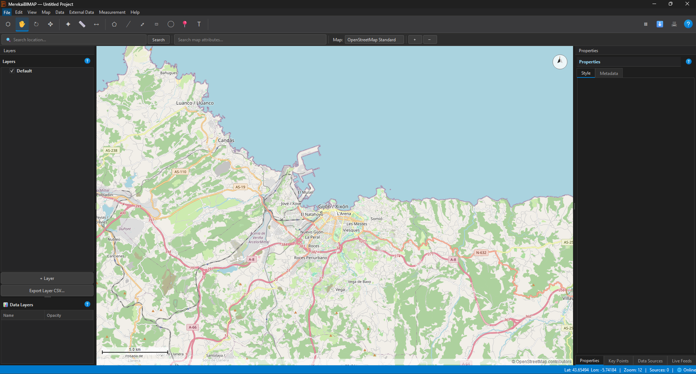

# MerekaiBIMAP — Quick Start Guide

[← Back to README](../readme.md) · [Full user manual](../MANUAL.md) · [Installation guide](INSTALL.md)

Create a simple map, add useful detail, and export it as a PDF.

## 1. Open or create a project

Start MerekaiBIMAP and choose **File → New Project** (`Ctrl+N`), or open an
existing `.bimap` project. Save your work with **File → Save** (`Ctrl+S`).

If you are running from source, follow the [installation guide](INSTALL.md),
then launch with `python -m bimap.app`.

## 2. Find the area you want to map

- Enter a place or address in the **Search location** field and press Enter.
- Choose a basemap from the map-provider selector.
- Pan and zoom to frame the area you want to show.

## 3. Add map elements

Use the toolbar to select a drawing tool:

- **Polygon**, **Rectangle**, or **Circle** to mark territories and areas.
- **Keypoint** to place an important location.
- **Text** to add a note or label.

Select an element to edit its appearance and details in the **Properties** panel.
Use the **Layers** panel to organise elements and control what is visible.

## 4. Add business data (optional)

Open **View → Show Data Sources** (`Ctrl+Shift+D`) and add a CSV/Excel file,
SQL source, REST API, or GeoJSON. Configure the source and refresh it to bring
its data into the project. For field mappings and advanced options, see the
[full user manual](../MANUAL.md#12-data-sources).

## 5. Export and share

1. Save the project with `Ctrl+S`.
2. Open **File → Print / Export PDF…** (`Ctrl+P`).
3. Choose page size and orientation; add a title block or legend if needed.
4. Select **Export PDF** and choose where to save the map.

To move a project with its linked local files, use **File → Export Data Backup…**
to create a `.bimap.zip`.

> **Safety:** Project files are readable JSON and may contain connection details.
> HTML/JavaScript extensions run when viewed. Share projects only with people
> you trust, and do not include production credentials.
